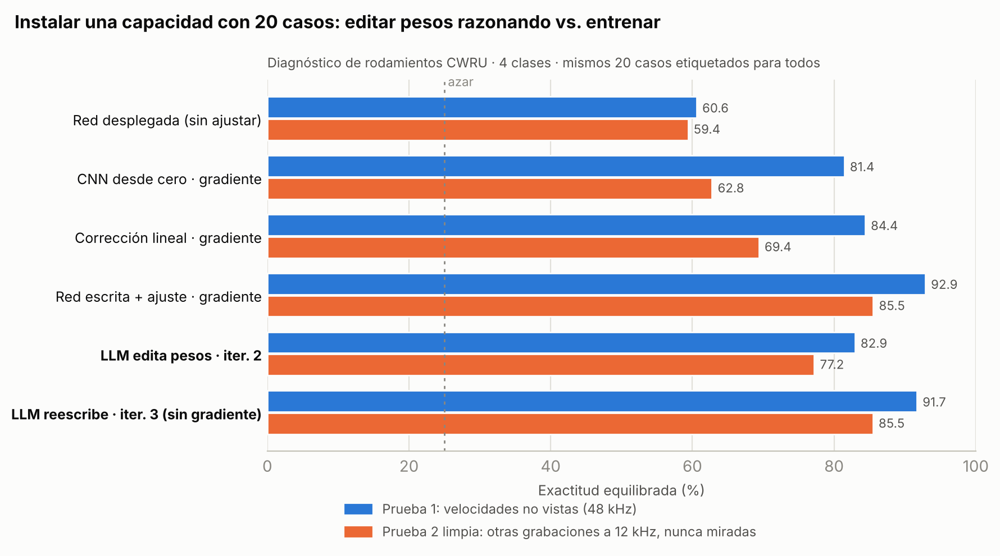

# Text-to-Weights (t2w)

### Un LLM enseña a una red neuronal desplegada algo que no sabía hacer, con 20 ejemplos y sin entrenarla

> **English summary.** We test whether a frontier LLM (Claude Opus 5.5) can replace gradient-based training by *writing and editing neural-network weights directly*. On real industrial vibration data (CWRU bearings), a deployed network that detects **0 %** of ball faults is given **20 labelled cases**. The LLM reads failure reports, analyses the cases and rewrites the weights in three reasoning iterations, with **no gradients, optimizers or automated search**. On a clean, never-inspected test set (different recordings, different acquisition rate, unseen fault size), the edited network reaches **85.5 %** balanced accuracy, **matching gradient fine-tuning on the same 20 cases (85.5 %)** and beating a CNN (62.8 %) and a linear probe (69.4 %) trained on them, with zero false alarms. Every step was pre-registered by git commit before evaluation.



---

## La pregunta

Entrenar una red exige un dataset. En la industria ese dataset casi nunca existe: los fallos son raros, caros de provocar y cambian con cada máquina. **¿Puede un LLM ocupar el lugar del entrenamiento?** Es decir: escribir los pesos de una red a partir de conocimiento y, cuando llegan unos pocos casos nuevos, corregirlos razonando, sin descenso de gradiente.

Lo único prohibido en todo el proyecto es **entrenar**: gradientes, optimizadores, ajustes por mínimos cuadrados, búsquedas automáticas que maximicen el acierto y copiar ejemplos a los pesos. Todo valor de cada peso sale de una fórmula o de un razonamiento escrito en el código.

## Resultados clave

| | Resultado |
|---|---|
| **Redes escritas sin ningún dato** (exp. 01–02) | En 4 tareas reales y 3 modalidades (vibración, imagen, sensores del móvil, voz) aciertan entre 2,3 y 6 veces más que el azar: 58,5 % rodamientos, 60 % dígitos, 60,5 % actividad y 47 % voz. |
| **Lo que vale la descripción de un LLM** (exp. 01–02) | Como punto de partida equivale a 1–3 ejemplos etiquetados por clase. En rodamientos probados a otras velocidades, +8–10 puntos incluso con todos los datos. |
| **Escala** (exp. 03) | Qwen2.5 de 0,5B a 14B no consigue escribir ni una red que funcione (0 de 15 intentos). La capacidad no es trivial. |
| **Aprendizaje sobre la marcha sin entrenar** (exp. 04) | Con 20 casos y 3 iteraciones de edición, la detección de bola pasa del 0 % al 79–83 % y el acierto global del 59 % al **85,5 %** en una prueba limpia, igual que el gradiente con los mismos datos. Cero falsas alarmas. |

## Experimentos

| # | Carpeta | Qué se prueba | Documentación |
|---|---|---|---|
| 01 | [`experiments/01_cwru_zero_data`](experiments/01_cwru_zero_data) | Red de diagnóstico de rodamientos escrita desde la física, sin datos, más su uso como punto de partida para entrenar con pocos datos. | [Protocolo](experiments/01_cwru_zero_data/PROTOCOL.md) · [Resultados](experiments/01_cwru_zero_data/RESULTADOS_v1.md) |
| 02 | [`experiments/02_task_battery`](experiments/02_task_battery) | La misma idea en dígitos manuscritos, actividad humana (UCI HAR) y voz (FSDD). | [Protocolo](experiments/02_task_battery/PROTOCOL_tasks.md) · [Resultados](docs/RESULTADOS_v2_bateria.md) |
| 03 | [`experiments/03_llm_size_sweep`](experiments/03_llm_size_sweep) | El mismo encargo a Qwen2.5 0,5B–14B oficiales (SHA-256 verificado), ejecutado en GitHub Actions. | [Resultados](experiments/03_llm_size_sweep/RESULTADOS.md) |
| **04** | [`experiments/04_online_weight_learning`](experiments/04_online_weight_learning) | **Un LLM instala una capacidad ausente en una red desplegada editando sus pesos, frente al gradiente con los mismos 20 casos.** | [Protocolos A](experiments/04_online_weight_learning/PROTOCOL.md) y [B](experiments/04_online_weight_learning/PROTOCOL_B.md) · [**Resultados**](experiments/04_online_weight_learning/RESULTADOS.md) |

## Cómo garantizamos que no hay trampa

- **Preregistro por commits.** Cada protocolo, cada red y cada edición se guardó en git *antes* de evaluar. El historial (`git log`) conserva las fechas reales, y los pesos de las redes congeladas tienen su SHA-256 en el repo.
- **Una sola evaluación.** Si algo se cambia después de ver un resultado, se publica como versión nueva junto a la anterior, nunca en su lugar. El experimento 02 tiene un ejemplo explícito (v1 frente a v2 del ajuste).
- **Prueba limpia.** En el experimento 04, al haber mirado una prueba durante la fase A, se añadió una segunda con grabaciones distintas que nadie miró hasta la evaluación final.
- **Mismos datos para todos.** Todos los métodos por gradiente usan exactamente los mismos 20 casos que el LLM, con 5 semillas.
- **Todo el razonamiento del LLM está en el código.** Cada edición (`experiments/04_online_weight_learning/edits/`) explica en su cabecera qué vio, qué cambia y por qué.

## Relación con el trabajo previo

El trabajo más cercano es **Weight-Space Programming** (MIT CSAIL, 2 nov 2026): GPT-6 Astra lee y edita pesos sin gradientes y elimina, por ejemplo, los bucles de razonamiento de Qwen3.5-0.8B. Sus propios autores y la prensa señalan que la edición sirve para **quitar obstáculos, no para instalar capacidades nuevas**. Este proyecto aporta precisamente eso: **instalar una capacidad ausente a partir de pocos casos**, en un bucle iterativo, con datos industriales reales y cambio de condiciones, **comparado contra el gradiente con exactamente los mismos ejemplos**. Más detalle en [`docs/RELATED_WORK.md`](docs/RELATED_WORK.md).

## Límites (leer antes de citar)

- Un solo LLM (Claude Opus 5.5). En el experimento 04, una sola tarea y un solo sorteo de los 20 casos para el LLM.
- Las ediciones se hicieron dentro de una conversación, no con un bucle automático por API. Los informes que leyó el LLM están guardados.
- CWRU, dígitos, HAR y FSDD son datasets públicos y muy conocidos. Falta replicarlo con datos propios o poco difundidos.
- Las redes escritas a mano funcionan donde el fenómeno se puede describir con física o reglas. Donde nadie sabe explicar el patrón, el entrenamiento sigue siendo necesario.

## Reproducir

```bash
git clone https://github.com/RobertoVetere/t2w-llm-sweep && cd t2w-llm-sweep
pip install torch numpy scipy scikit-learn matplotlib
./scripts/get_data.sh                      # descarga CWRU, UCI HAR y FSDD en ./data

# 01: red de rodamientos sin datos (evaluación ciega) y punto de partida
cd experiments/01_cwru_zero_data && python evaluate.py && python ft_experiment.py && cd -
# 02: batería de tareas
cd experiments/02_task_battery && for t in digits har fsdd; do python run_tasks.py $t; python run_residual.py $t; done && cd -
# 04: aprendizaje sobre la marcha (informes, ediciones y evaluación final de las fases A y B)
cd experiments/04_online_weight_learning && python report.py v1 && python final_eval.py && python final_eval_B.py
```
El experimento 03 se lanza desde *Actions → llm-sweep → Run workflow*.

## Estructura

```
experiments/
  01_cwru_zero_data/        red escrita desde la física, evaluación ciega, punto de partida
  02_task_battery/          dígitos, actividad humana, voz
  03_llm_size_sweep/        Qwen 0,5B–14B escribiendo la misma red (GitHub Actions)
  04_online_weight_learning/
    PROTOCOL*.md            preregistros
    reports/                lo que leyó el LLM en cada iteración
    edits/iter{1,2,3}.py    las ediciones de pesos, con su razonamiento
    results_final*.json     resultados
docs/                       trabajo relacionado, resultados de la batería, figuras
scripts/get_data.sh         descarga de datos
```

---
Proyecto de Roberto Vetere. Redes, ediciones y análisis escritos por Claude Opus 5.5 (Anthropic) en sesiones de investigación guiadas.
