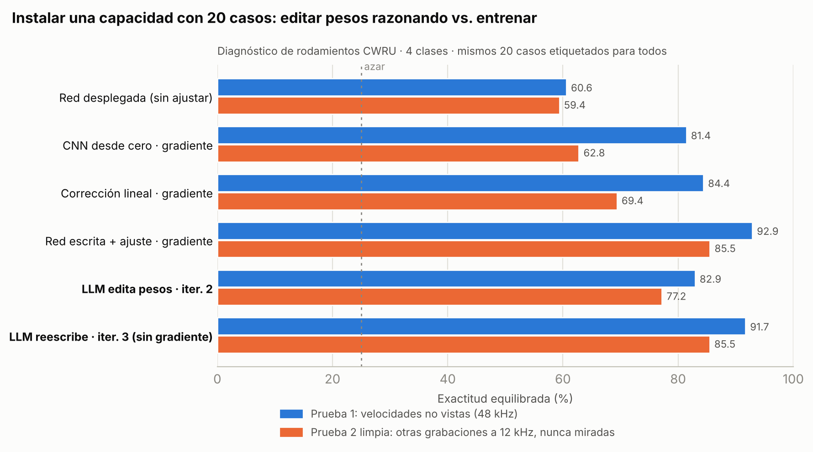

# Experimento 04: un LLM instala una capacidad nueva en una red desplegada, sin entrenarla

**Escenario.** La red v1 de diagnóstico de rodamientos está desplegada y casi nunca detecta los fallos de bola (0 %). Llegan **20 casos etiquetados** (5 por clase, de 1730 y 1750 rpm). Claude Opus 5.5 lee informes de fallos, analiza esos casos y **edita los pesos a mano**. No hay gradientes, optimizadores ni búsquedas automáticas. Al final se evalúa una sola vez.

Protocolos: [`PROTOCOL.md`](PROTOCOL.md) (fase A) y [`PROTOCOL_B.md`](PROTOCOL_B.md) (fase B). Cada paso tiene su commit antes de evaluar.

## Las dos pruebas
- **Prueba 1:** todas las ventanas de 1772 y 1797 rpm a 48 kHz (387), es decir, velocidades que no aparecen en el feedback.
- **Prueba 2, limpia:** otras grabaciones de la misma máquina a 1772 y 1797 rpm, adquiridas a 12 kHz (630 ventanas). Incluyen un tamaño de fallo, 28 milésimas, que no existe en el feedback. Nadie miró estos datos antes de la evaluación final. Hizo falta añadirla porque el acierto de iter2 en la prueba 1 ya se había visto.

## Resultados (exactitud equilibrada, 4 clases; azar = 25 %)

| Método | Datos de ajuste | Gradiente | Prueba 1 | Prueba 2 limpia | Bola (P1 / P2) | Falsas alarmas (P1 / P2) |
|---|---|---|---|---|---|---|
| Red desplegada v1 | 0 | no | 60,6 | 59,4 | 0 / 2 | 0/30 / 0/30 |
| CNN desde cero | 20 casos | sí | 81,4 ± 1,5 | 62,8 ± 3,4 | 46 / 42 | – |
| Corrección lineal sobre espectro | 20 casos | sí | 84,4 ± 1,3 | 69,4 ± 0,8 | 97 / 94 | – |
| Red escrita + ajuste por gradiente | 20 casos | sí | **92,9** ± 0,1 | **85,5** ± 0,1 | 86 / 87 | – |
| **LLM, iter. 1** (edita la cabeza) | 20 casos | **no** | 81,0 | – | 42 / – | 0/30 / – |
| **LLM, iter. 2** (edita la cabeza) | 20 casos | **no** | 82,9 | 77,2 | 43 / 47 | 0/30 / 0/30 |
| **LLM, iter. 3** (reescribe la red) | 20 casos | **no** | **91,7** | **85,5** | **83 / 79** | **0/30 / 0/30** |

Los métodos por gradiente son la media de 5 semillas, con los mismos 20 casos. Con 5 sorteos distintos de los 20 casos (prueba 1), los resultados son: red escrita + gradiente 93,6 ± 0,7, corrección lineal 81,7 ± 4,6 y CNN 78,3 ± 4,8.

LLM iter. 3 en la prueba 2, acierto por tamaño de fallo: 7 milésimas 98 %, 14 milésimas 63 %, 21 milésimas 90 %, **28 milésimas (tamaño nunca visto) 51 %**, sanas 100 %.

## Qué muestra
1. **Instala una capacidad ausente sin gradientes.** La detección de bola pasa del 0 % al 83 % (prueba 1) y al 79 % (prueba 2 limpia) con 20 casos y razonamiento. No es quitar un obstáculo, que es el límite que reconoce el trabajo de Weight-Space Programming del MIT: la red no tenía ningún mecanismo para la bola y el LLM se lo escribió.
2. **Iguala al gradiente con los mismos datos.** En la prueba limpia, 85,5 frente a 85,5. Y los métodos que solo aprenden de los datos se hunden al cambiar el sistema de adquisición: la CNN cae al 62,8 y la corrección lineal al 69,4.
3. **Cero falsas alarmas** en las dos pruebas, y cada decisión se puede leer en el código (`edits/iter3.py`).
4. **La clave fue un rasgo que la red tiraba.** La v1 normalizaba la señal y perdía el nivel de vibración. Al ver los casos en crudo, el LLM lo recuperó como primer criterio de diagnóstico, igual que lo haría un técnico de mantenimiento, y construyó la bola como diagnóstico por exclusión.

## Lo que hay que decir con honestidad
- **Un solo LLM, una sola tarea y un solo sorteo de feedback para el LLM.** Los métodos por gradiente tienen 5 semillas y 5 sorteos; el LLM solo uno, porque cada iteración es trabajo de razonamiento. Falta repetirlo con otros sorteos y en otras tareas.
- **Las iteraciones 1 y 2 se hicieron en la conversación**, no como un bucle automático por API. El prompt efectivo son los informes de `reports/`, todos guardados.
- **CWRU es un dataset muy conocido.** El LLM puede tener conocimiento previo de él. Pesa a favor de la tesis que la prueba 2 incluya un tamaño de fallo no visto y otro sistema de adquisición, pero hay que replicarlo con un dataset propio o poco conocido.
- **El mejor método por gradiente también parte de la red escrita por el LLM.** Las dos vías ganadoras usan conocimiento del LLM; las que parten de cero se quedan atrás.
- Entre la fase A y la B el LLM ganó acceso a herramientas de análisis. Así está documentado en `PROTOCOL_B.md`.
